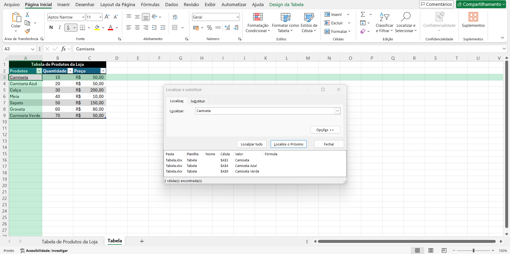
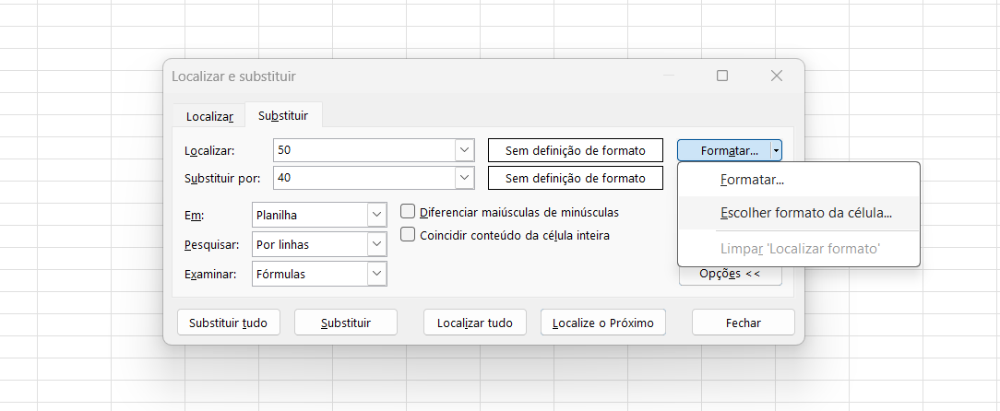

# Localizar e Substituir

> **Data:** 16 de novembro de 2026

As ferramentas Localizar e Substituir ajudam a encontrar informações e modificar dados rapidamente, principalmente em planilhas grandes.

---

## 🔎 Localizar

Permite procurar um dado específico dentro da planilha.

Caminho:
1. Acesse a guia Página Inicial.
2. Clique em **Localizar e Selecionar**.
3. Escolha **Localizar...**
4. Digite o conteúdo que deseja encontrar.

Na janela de pesquisa:
- `Localize o próximo`: encontra a próxima ocorrência do dado.
- `Opções >>`: apresenta configurações adicionais para refinar a pesquisa.

Uma opção importante é **"Coincidir conteúdo da célula inteira"**, que faz com que o Excel encontre apenas células cujo conteúdo seja exatamente igual ao termo pesquisado.

---

## 🔄 Substituir

Permite trocar um dado por outro sem precisar editar cada célula manualmente.

Caminho:
1. Acesse Página Inicial.
2. Clique em Localizar e Selecionar.
3. Escolha **Substituir...**

Na janela, existem dois campos:
- **Localizar**: informe o conteúdo que deseja substituir.
- **Substituir por**: informe o novo conteúdo.

É possível utilizar duas opções:
- `Substituir`: troca uma ocorrência por vez.
- `Substituir tudo`: troca todas as ocorrências encontradas de uma vez.

### Opções avançadas

O Excel permite refinar a substituição para evitar alterações em dados que não deveriam ser modificados.

Por exemplo: imagine uma planilha com duas colunas contendo o número 50, mas queremos alterar somente os valores de *R$ 50* para *R$ 40*.

Para isso:
1. Na janela Substituir, clique em Opções.
2. Na linha correspondente a Localizar, clique em **Formatar**.
3. Depois, clique em **Escolher formato da célula...**

4. Selecione o formato utilizado nos dados que deseja localizar.
5. Faça a substituição normalmente.

Assim, é possível restringir a busca também pela formatação da célula, evitando substituir outros valores que tenham o mesmo número, mas utilizem formatos diferentes.
