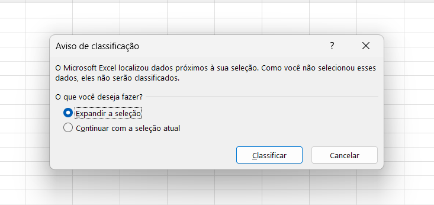
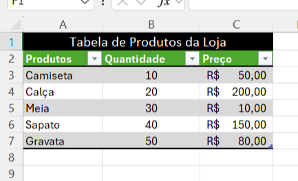
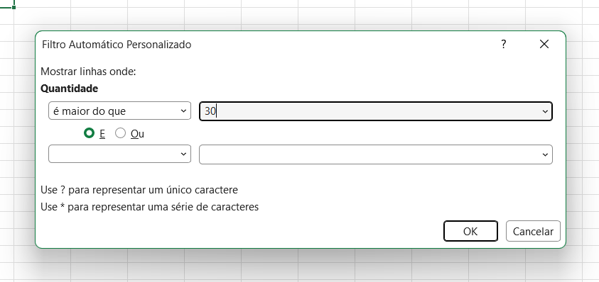

# Organização de Tabelas

> **Data:** 20 de novembro de 2026

A organização de tabelas permite visualizar os dados de diferentes maneiras, facilitando a consulta e a análise das informações.

---

## Classificar dados

O recurso de classificação permite organizar os dados de acordo com uma ordem específica, como ordem alfabética ou valores numéricos.

**Exemplo: organizar produtos em ordem alfabética.**

1. Selecione uma célula da coluna de produtos.
2. Acesse **Página Inicial → Classificar e Filtrar**.
3. Escolha **Classificar de A a Z** ou **Classificar de Z a A**.
4. Na janela que aparecer, mantenha selecionada a opção **Expandir a seleção**.
5. Clique em **Classificar**.

**Entendendo as opções:**

- **Expandir a seleção:** organiza a coluna escolhida e mantém os demais dados de cada linha juntos, preservando as informações relacionadas.
- **Continuar com a seleção atual:** organiza somente a coluna selecionada, podendo deixar os dados das outras colunas desalinhados.

⚠️ Normalmente, utilize **Expandir a seleção** para manter os registros da tabela organizados corretamente.

### Classificar por preço

Também é possível organizar os dados utilizando valores numéricos.

1. Selecione uma célula da coluna de preços.
2. Acesse **Página Inicial → Classificar e Filtrar**.
3. Escolha uma das opções:
   - **Classificar do Menor para o Maior:** organiza os preços em ordem crescente.
   - **Classificar do Maior para o Menor:** organiza os preços em ordem decrescente.
4. Mantenha a opção **Expandir a seleção** e clique em **Classificar**.

---

## Aplicar filtros

Os filtros permitem exibir somente os dados que atendem a determinados critérios, sem precisar excluir as demais informações da tabela.

**Como ativar:**

1. Selecione os cabeçalhos da tabela.
2. Acesse **Página Inicial → Classificar e Filtrar**.
3. Clique em **Filtrar**.

Após ativar o recurso, pequenas setas aparecerão nos cabeçalhos das colunas.

7

Ao clicar nessas setas, você poderá:

- Pesquisar um dado específico.
- Selecionar quais informações deseja visualizar.
- Aplicar filtros numéricos e outras condições.

### Filtros numéricos

Os filtros também permitem definir condições para os valores numéricos.

Por exemplo, é possível exibir somente os produtos com quantidade **maior que 30**, ocultando temporariamente os registros que não atendem a esse critério.

### Limpar filtros

Para voltar a visualizar todos os registros, utilize a opção **Limpar Filtro** na seta da coluna filtrada.

Isso remove o critério aplicado e volta a exibir os dados da tabela.
