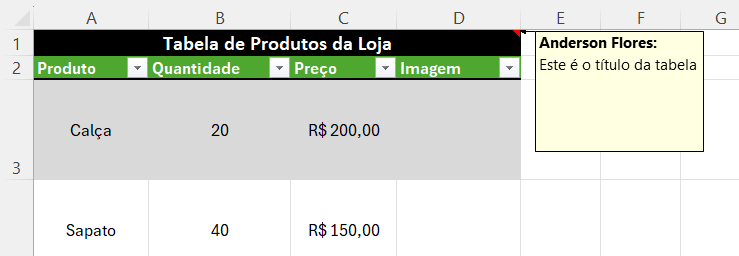
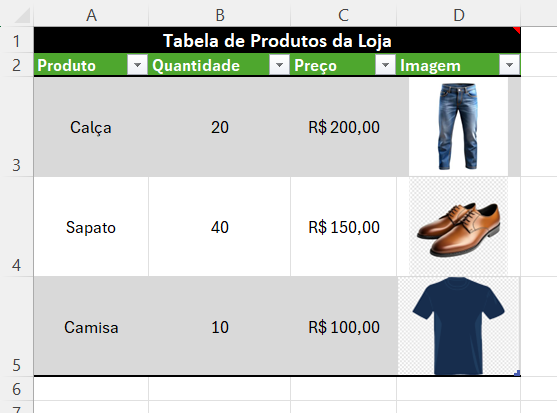
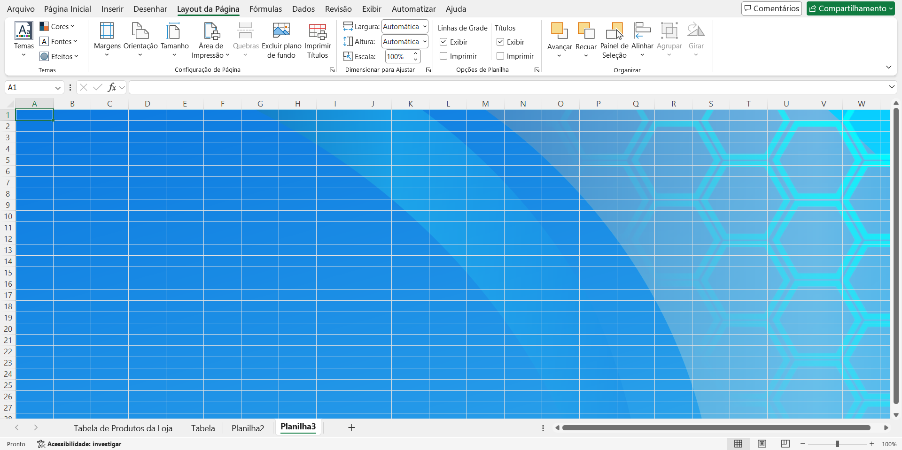

# Anotações e Imagens

> **Data:** 24 de novembro de 2026

As anotações permitem adicionar observações às células, enquanto as imagens ajudam a complementar e personalizar visualmente as planilhas.

---

## 💬 Adicionar anotações às células

As anotações permitem adicionar observações a uma célula, sendo úteis para registrar explicações sobre determinadas informações.

Por exemplo, ao modificar um dado, podemos adicionar uma anotação explicando o motivo daquela alteração.

**Como adicionar:**

1. Clique com o botão direito na célula desejada.
2. Selecione **Nova Anotação**.
3. Digite o texto que deseja registrar.
4. Clique em qualquer local fora da anotação para finalizar.

Após adicionar uma anotação, a célula apresentará uma pequena marca vermelha no canto superior direito.

Ao passar o mouse sobre ela, o conteúdo da anotação será exibido.

**Outras opções:**

- **Mostrar/Ocultar Anotação:** permite deixar a anotação visível ou escondê-la novamente.
- **Excluir Anotação:** remove a anotação da célula.

---

## 🖼️ Inserir imagens na planilha

A inserção de imagens permite personalizar a aparência da planilha, tornando tabelas e apresentações mais atrativas.

Existem diferentes maneiras de utilizar imagens no Excel, seja posicionando-as sobre as células, inserindo-as diretamente nelas ou utilizando-as como plano de fundo.

### 1. Inserir imagens sobre as células

Permite adicionar uma imagem como um objeto independente, que pode ser posicionado livremente pela planilha.

**Como inserir:**

1. Acesse a guia **Inserir**.
2. Clique em **Ilustrações → Imagens**.
3. Selecione **Colocar Sobre as Células**.
4. Escolha a imagem desejada no dispositivo.

Depois de inserir a imagem, você poderá clicar e arrastá-la para posicioná-la livremente pela planilha.

**Personalização:**

Ao selecionar a imagem, aparecerá a guia **Formato de Imagem**, que disponibiliza diversas opções:

- Alterar cores.
- Aplicar molduras e efeitos.
- Girar ou inverter a imagem.
- Cortar a imagem.
- Modificar altura e largura.
- Redefinir a imagem, removendo as modificações aplicadas.

Para redimensionar, utilize os pontos localizados nos cantos da imagem, preservando suas proporções.

**Exemplo de utilização em tabelas:**

Podemos criar uma coluna chamada IMAGEM e adicionar uma foto correspondente a cada produto.

1. Insira a imagem sobre as células.
2. Posicione-a sobre a célula correspondente ao produto.
3. Ajuste seu tamanho para que fique dentro dos limites da célula.
4. Repita o procedimento para os demais produtos.

Dessa forma, as imagens ficam alinhadas visualmente aos seus respectivos produtos.

**OBS:** imagens inseridas sobre as células ficam na frente do conteúdo delas. Portanto, qualquer texto existente na célula pode ficar encoberto pela imagem.

### 2. Inserir imagens diretamente nas células

O Excel também permite inserir imagens diretamente dentro das células, facilitando a organização de imagens em tabelas.

**Como inserir:**

1. Selecione a célula desejada.
2. Acesse a guia **Inserir**.
3. Clique em **Ilustrações → Imagens**.
4. Selecione **Colocar na Célula**.
5. Escolha a imagem desejada no dispositivo.

A imagem será inserida diretamente na célula selecionada, ajustando-se automaticamente ao espaço disponível.

Essa opção facilita a organização de imagens em tabelas, pois não é necessário posicionar e redimensionar cada imagem manualmente.

**Utilizando filtros:** tanto as imagens inseridas sobre as células quanto as inseridas diretamente nelas podem acompanhar seus respectivos registros quando aplicamos filtros em uma tabela, facilitando a identificação dos produtos.

### 3. Inserir uma imagem como plano de fundo

Outra possibilidade é utilizar uma imagem como fundo de toda a planilha, em vez de posicioná-la individualmente sobre as células.

**Como inserir:**

1. Acesse a guia **Layout da Página**.
2. Clique em **Plano de Fundo**.
3. Escolha **De um Arquivo**.
4. Selecione a imagem desejada no dispositivo e clique em **Abrir**.

A imagem será aplicada como plano de fundo da planilha, permitindo continuar escrevendo e preenchendo as células normalmente.

**Como remover:**

1. Acesse novamente **Layout da Página**.
2. Clique em **Excluir Plano de Fundo**.

Assim, a imagem será removida da planilha.
